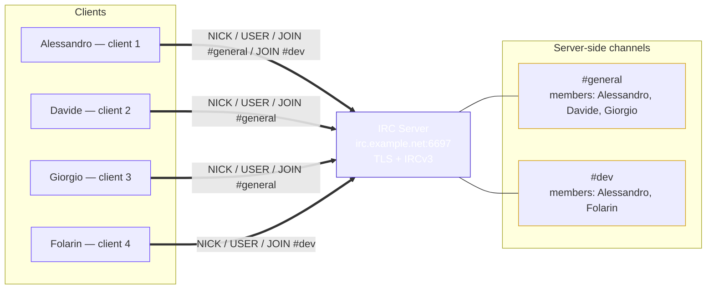
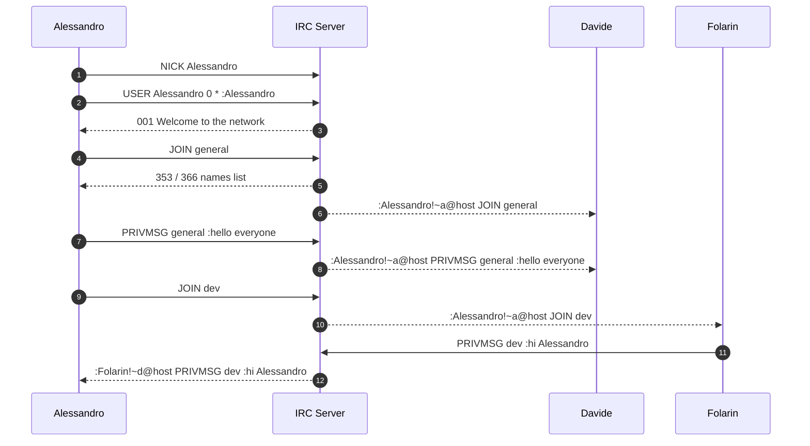

# IRC Server Layout

A minimal reference layout: one IRC server, four connected clients, and two
server-side channels. Alessandro is in both channels, which is how a single client
can hold multiple memberships at once.

## Network & Channel Layout

Each client holds one TCP connection to the server. Channels
are not peer-to-peer: `#general` and `#dev` exist only as objects on the server,
and every message is relayed through it. That is why Alessandro can be in two
channels over a single socket.

## Message Flow

## Notes

- **Ports:** 6667 is the classic plaintext port; 6697 is the conventional TLS
  port.
- **Prefixes:** outgoing messages carry a `:nick!user@host` prefix added by the
  server, not by the sending client.
- **Channel ops:** membership alone grants voice; `MODE #general +o Alessandro`
  grants operator privileges such as `KICK` and topic control.
